# SRSS – Pipeline & Toàn Bộ Chức Năng Hệ Thống

> **SRSS (Systematic Review Support System)** – Hệ thống Web hỗ trợ thực hiện Systematic Literature Review (SLR) theo chuẩn **PRISMA 2020**.
> Tài liệu này tổng hợp luồng (flow) và chức năng của hệ thống dưới dạng **pipeline**, dựa trên mã nguồn Front-End (`src/routes`, `src/pages`, `src/services`).

---

## Mục lục

1. [Pipeline tổng thể](#1-pipeline-tổng-thể)
2. [Vai trò & phân quyền](#2-vai-trò--phân-quyền)
3. [Stage 0 – Xác thực & điều hướng](#3-stage-0--xác-thực--điều-hướng)
4. [Stage A – Planning (Lập kế hoạch)](#4-stage-a--planning-lập-kế-hoạch)
5. [Stage B – Conducting (Thực hiện)](#5-stage-b--conducting-thực-hiện)
   - [B1. Identification](#b1-identification--thu-thập-bài-báo)
   - [B2. Paper Pool & Deduplication](#b2-paper-pool--deduplication--snowballing)
   - [B3. Review Process](#b3-review-process--khởi-tạo-quy-trình-phản-biện)
   - [B4. Study Selection (Screening)](#b4-study-selection--sàng-lọc)
   - [B5. Quality Assessment](#b5-quality-assessment--đánh-giá-chất-lượng)
   - [B6. Data Extraction](#b6-data-extraction--trích-xuất-dữ-liệu)
   - [B7. Synthesis](#b7-synthesis--tổng-hợp-bằng-chứng)
6. [Stage C – Reporting (Báo cáo)](#6-stage-c--reporting-báo-cáo)
7. [Chức năng xuyên suốt (Cross-cutting)](#7-chức-năng-xuyên-suốt-cross-cutting)
8. [Phân hệ Admin](#8-phân-hệ-admin)
9. [Bản đồ Route](#9-bản-đồ-route)
10. [Kiến trúc kỹ thuật Front-End](#10-kiến-trúc-kỹ-thuật-front-end)

---

## 1. Pipeline tổng thể

Hệ thống chia SLR thành **3 giai đoạn lớn** (theo `src/constants/slrWorkflow.ts`): **A. Planning → B. Conducting → C. Reporting**.

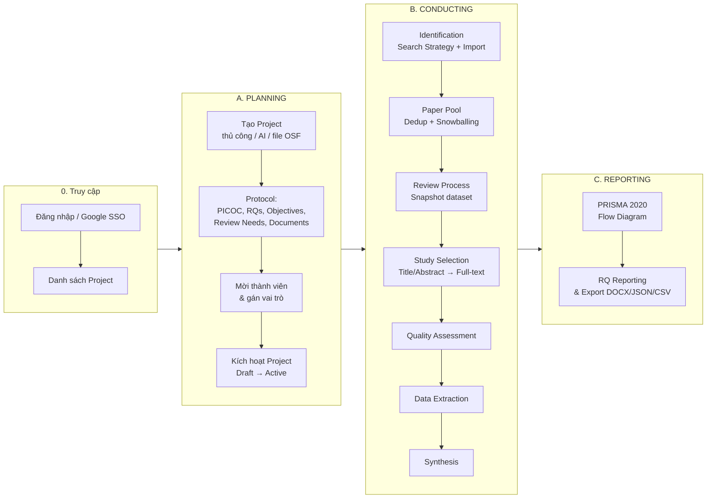

### Pipeline dạng bảng (Input → Xử lý → Output)

| # | Stage | Input | Xử lý chính | Output | Người thực hiện |
|---|-------|-------|-------------|--------|-----------------|
| 0 | Auth | Tài khoản | Login / Google / refresh token | Session (JWT) | Mọi user |
| A1 | Tạo Project | Ý tưởng đề tài | Tạo thủ công / AI Setup Wizard / import OSF | Project (Draft) | Leader |
| A2 | Protocol | Project | PICOC Wizard, RQ, Objectives, Review Needs | Protocol hoàn chỉnh | Leader |
| A3 | Thành viên | Danh sách user | Gửi lời mời, gán role | Team | Leader |
| A4 | Kích hoạt | Protocol + Team | Activate | Project (Active) | Leader |
| B1 | Identification | PICOC, nguồn DB | Search strategy, search execution, import RIS/BibTeX/DOI/PDF/Crossref | Import batches | Leader |
| B2 | Paper Pool | Import batches | Lọc, dedup, snowballing, thống kê | Bộ bài báo sạch | Leader |
| B3 | Review Process | Paper Pool | Tạo process, chọn bài (theo filter/selection) → snapshot | Dataset cố định | Leader |
| B4 | Screening | Snapshot | Phân công 2 reviewer, vote Include/Exclude, AI gợi ý, giải quyết conflict | Bài Included | Reviewer + Leader |
| B5 | QA | Bài Included | Checklist chấm điểm, auto-resolve, ngưỡng | Bài đạt chất lượng | Reviewer + Leader |
| B6 | Extraction | Bài đạt QA | Form trích xuất, AI auto-extract, consensus | Ma trận dữ liệu | Reviewer + Leader |
| B7 | Synthesis | Dữ liệu trích xuất | Theme, evidence matrix, charts, RQ findings | Kết quả tổng hợp | Leader |
| C | Reporting | Toàn bộ số liệu | PRISMA flow, bảng loại trừ, export | Báo cáo PRISMA 2020 | Leader |

---

## 2. Vai trò & phân quyền

| Vai trò | Mã | Phạm vi |
|---------|----|---------|
| **System Admin** | `Admin` | Toàn hệ thống: user, project, template, nguồn dữ liệu, AI agent, audit log |
| **Project Leader** | Project role `1` | Toàn quyền trong project: protocol, import, phân công, mở/đóng phase, giải quyết conflict, báo cáo |
| **Reviewer (Member)** | Project role `2` | Sàng lọc, chấm QA, trích xuất dữ liệu trên bài được giao (blind review) |
| **Third Reviewer** | Project role `3` | Tham gia phân xử khi có xung đột ở Screening |
| **AI Agent** | Token theo project | Agent bên ngoài nhận task & gửi vote (qua Agent Task API / MCP) |

| Tính năng | Admin | Leader | Reviewer |
|-----------|:-----:|:------:|:--------:|
| Quản lý user, cấu hình hệ thống | ✅ | ❌ | ❌ |
| Tạo project, sửa PICOC/RQ | ✅ | ✅ | ❌ |
| Import bài, dedup, phân công | ✅ | ✅ | ❌ |
| Start / Complete / Reopen phase | ✅ | ✅ | ❌ |
| Giải quyết conflict / consensus | ✅ | ✅ | ❌ |
| Vote screening, chấm QA, trích xuất | ✅ | ✅ | ✅ |
| Xem protocol & tiến độ | ✅ | ✅ | ✅ (chỉ xem) |

Guard: `ProtectedRoute` (đăng nhập / role hệ thống), `ProtectedRouteForProject` (role trong project), `SectionGuard`, `InteractionGuard`, `AdminAccessGuard`.

---

## 3. Stage 0 – Xác thực & điều hướng

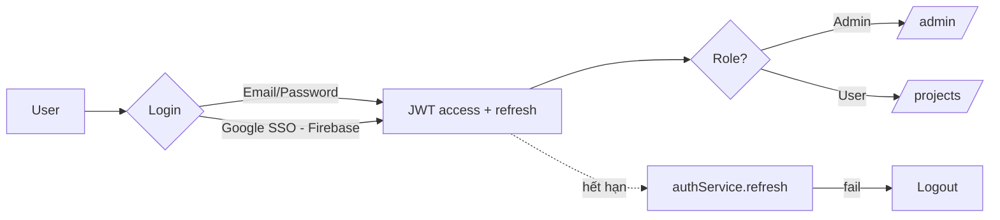

**Chức năng** (`authService`, `userService`, `invitationService`):
- Đăng nhập, đăng ký, Google login, quick login (demo), tự refresh token khi khởi động app.
- Trang chính sách (`/auth/policy`).
- Hồ sơ cá nhân: cập nhật profile, đổi mật khẩu, xem tiến độ cá nhân (`getProgressOverview`).
- Lời mời tham gia project: xem chi tiết, **chấp nhận / từ chối** (`/invitations/:id`).
- Trang chủ (Home) giới thiệu luồng PRISMA.

---

## 4. Stage A – Planning (Lập kế hoạch)

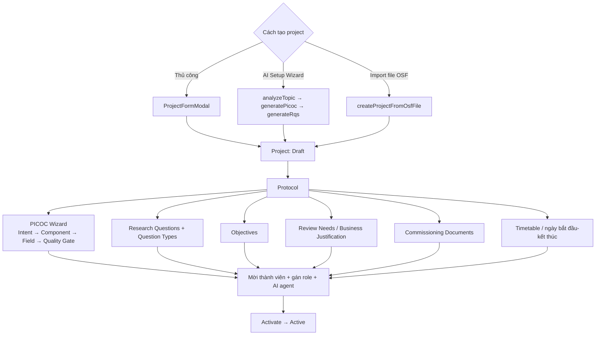

**Chức năng chi tiết**

| Nhóm | Chức năng | Service |
|------|-----------|---------|
| Project CRUD | Tạo, sửa, xoá mềm, khôi phục, archive, complete, export Excel | `projectService` |
| AI Setup Wizard | Phân tích chủ đề, sinh PICOC, sinh RQ, xem/sửa setup | `aiProjectSetupService` |
| PICOC Wizard | Lưu/khôi phục trạng thái, gợi ý (suggest/batch), phân loại theo taxonomy, kiểm tra ngữ nghĩa (semantic check), export file, analytics | `picocWizardStateService` |
| Protocol | CRUD PICOC elements, Research Questions, Objectives, Review Needs, Documents | `coreAndGovernanceService` |
| Thành viên | Gửi lời mời, huỷ lời mời, đổi role, xoá thành viên, thay Leader | `projectService`, `invitationService` |
| AI Agent | Gán agent cho project, cấp/rotate token | `ProjectAgentAssignments` |
| Checklist PRISMA | Clone template vào review, cập nhật item, xem % hoàn thành, generate report | `checklistService` |
| Overview | SLR Workflow Overview, Step progress nav, Project header | `ProjectDetailPage` |

---

## 5. Stage B – Conducting (Thực hiện)

### Paper Pool Workspace – 5 bước chuẩn bị (`PoolWorkflowStepper`)

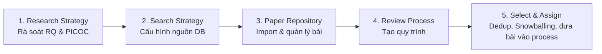

Route: `/projects/:id/workspace/:stepId` (stepId 1–5). Chỉ Leader được điều khiển các bước.

---

### B1. Identification – Thu thập bài báo

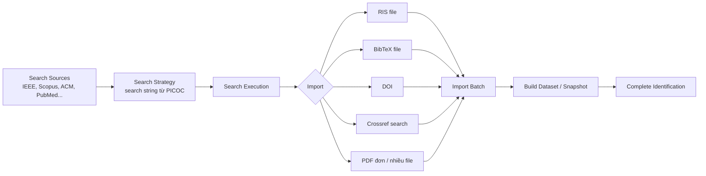

**Chức năng**
- **Search Source**: chọn từ Master Sources (do Admin quản lý), upsert hàng loạt, `analyzePicoc` gợi ý chuỗi tìm kiếm, cập nhật strategy.
- **Search Execution**: tạo / sửa / xoá lượt tìm kiếm, ghi số lượng kết quả, lấy thống kê PRISMA.
- **Import**: RIS, BibTeX, DOI, Crossref Works Explorer (tìm & lọc), PDF; theo dõi tiến độ import; resolve/reject bản ghi lỗi; Quick Import.
- **Import Batch**: xem danh sách batch, xem bài trong batch, sửa/xoá batch.
- **Identification Process**: start / complete / reopen, `getReadyPapers`, thêm bài vào snapshot.
- Tabs: Strategies · Searches · Import Batches · Papers Library · Build Dataset; PRISMA Summary Cards.

---

### B2. Paper Pool, Deduplication & Snowballing

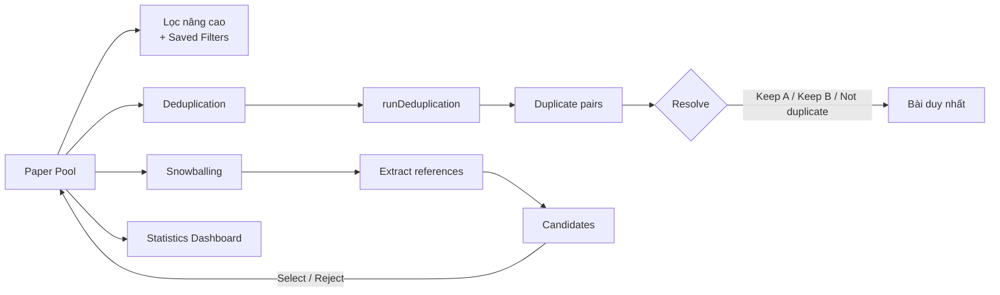

**Chức năng**
- **Paper Pool**: bảng bài báo, lọc theo metadata, lưu/sửa/xoá bộ lọc (Filter Collections), bulk action, xoá bài, xoá PDF.
- **Deduplication**: chạy dedup tự động, hàng đợi cặp trùng, so sánh song song, đánh dấu trùng thủ công, phím tắt bàn phím.
- **Snowballing**: trích xuất references từ bài gốc, danh sách candidate, chọn / từ chối, xem chi tiết candidate.
- **Paper Details**: metadata, abstract, references, access panel (PDF/DOI).
- **Statistics**: tổng quan, theo năm, loại xuất bản, ngôn ngữ, top journals/conferences/publishers/keywords, trạng thái full-text, chất lượng dữ liệu.

---

### B3. Review Process – Khởi tạo quy trình phản biện

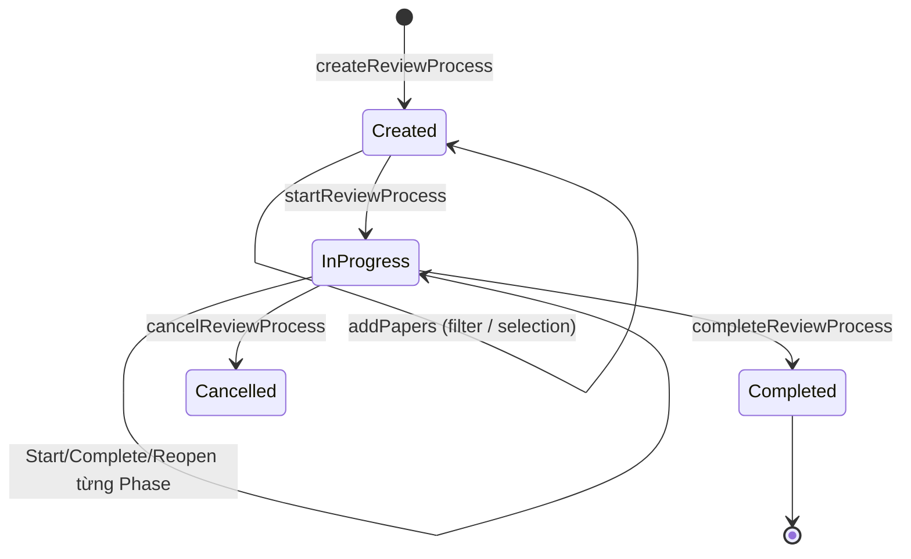

**Chức năng** (`reviewProcessService`, `ReviewProcessWorkspace`)
- Tạo / sửa / xoá / huỷ process, thêm bài từ **filter setting** hoặc **danh sách chọn**, xem các snapshot.
- Điều phối phase: **Start Phase, Complete Phase, Reopen Phase**.
- Dashboard process: Phase stepper, Phase stats, Progress overview, Team members, Activity timeline, Alerts, Notes.

Thứ tự phase trong một Review Process:

```
Identification → Study Selection (TA → FT) → Quality Assessment → Data Extraction → Synthesis → PRISMA Report
```

---

### B4. Study Selection – Sàng lọc

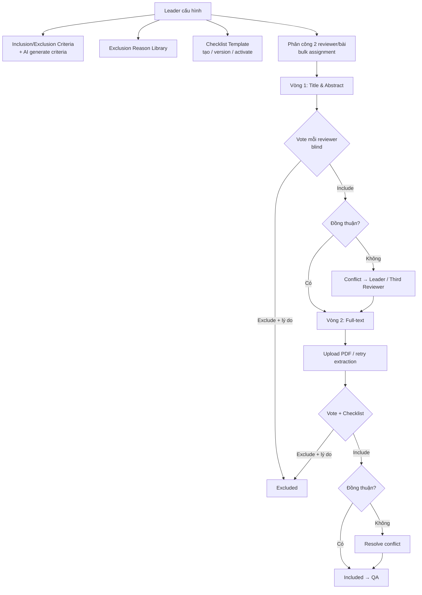

**Chức năng Leader** (`ManageStudySelectionPage`, `StuSePaperStatisticPage`)
- Start / complete screening, cài đặt process, quản lý exclusion code (bật/tắt, thêm hàng loạt).
- Bảng phân công Title/Abstract & Full-text, gán Third Reviewer.
- Xem tiến độ từng reviewer, thống kê Include/Exclude theo reviewer.
- Danh sách conflict theo phase, chi tiết conflict, **resolve conflict**, bulk resolve, theo dõi tiến độ resolution cuối.
- Bulk add vào dataset, xem dataset đã chọn.
- Tab **AI Analysis**: kết quả đánh giá AI theo tiêu chí.

**Chức năng Reviewer** (`TitleAbstractScreeningWorkspace`, `FullTextScreeningWorkspace`)
- Hàng đợi bài được giao, điều hướng bài trước/sau, phím tắt.
- Decision: **Include / Exclude (chọn lý do) / ghi chú**.
- Selection checklist theo template, nộp submission.
- **AI hỗ trợ**: `evaluateAi`, `evaluateFullTextAi`, xem phân tích AI, gợi ý metadata (apply metadata).
- **Citation graph** (Cytoscape), references, top cited.
- Đọc PDF trực tiếp (pdf.js) có highlight, upload full-text PDF.
- Panel **AI Agent** của reviewer (agent bên ngoài vote theo task).

---

### B5. Quality Assessment – Đánh giá chất lượng

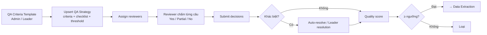

**Chức năng** (`qualityAssessmentService`)
- Quản lý template tiêu chí QA (tạo/sửa/xoá), bulk criteria & checklists, upsert strategy.
- Start / complete QA, phân công reviewer, danh sách bài được giao.
- Reviewer submit / update decisions; Leader submit / update resolution, **auto-resolve**, reopen paper.
- Bảng tiến độ reviewer, **export CSV**.

---

### B6. Data Extraction – Trích xuất dữ liệu

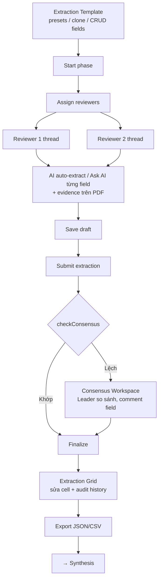

**Chức năng** (`dataExtractionService`, `dataExtractionConductingService`)
- Template: danh sách, presets, clone, tạo/sửa/xoá field (hỗ trợ nested field).
- Dashboard, workload summary, phân công reviewer, start / complete phase, reopen extraction.
- Reviewer workspace: form + PDF panel, toạ độ evidence, save draft, submit, preview.
- AI: `autoExtractWithAI`, `askAiSingleField`.
- Consensus: workspace đối chiếu 2 reviewer, lưu draft consensus, finalize, comment theo field.
- Grid workspace (AG Grid): sửa cell, lịch sử audit từng cell.
- Export dữ liệu đã trích xuất (JSON / CSV).

---

### B7. Synthesis – Tổng hợp bằng chứng

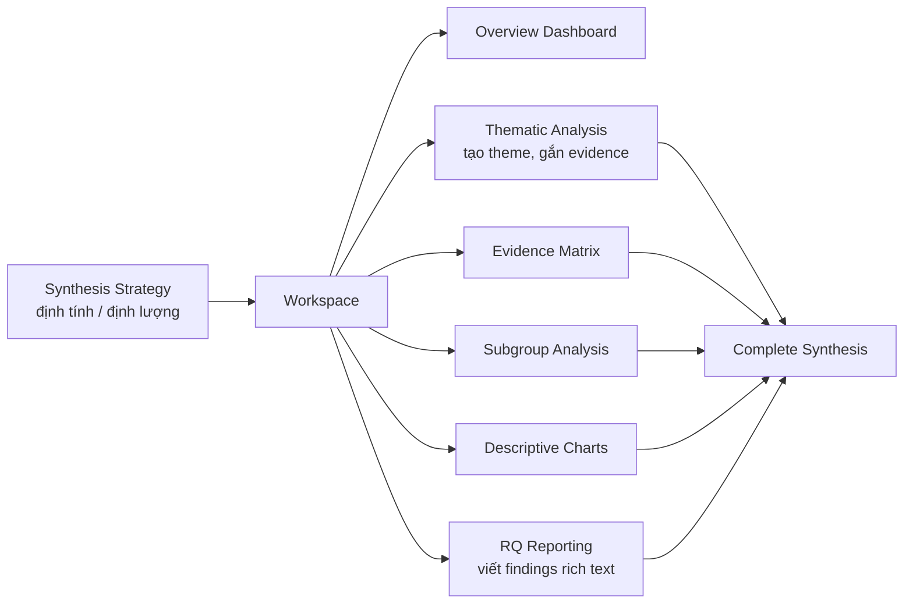

**Chức năng** (`synthesisExecutionService`)
- Upsert chiến lược tổng hợp + hướng dẫn chiến lược.
- Start / complete phase; lấy nhóm dữ liệu nguồn (source data groups).
- CRUD Theme, thêm/xoá evidence vào theme.
- Lưu finding cho từng RQ (Rich Text Editor – TipTap).
- Biểu đồ mô tả (Recharts), ma trận bằng chứng, phân tích nhóm con.

Routes: `/projects/:projectId/synthesis/{overview | thematic-analysis | descriptive-charts | rq-reporting}`.

---

## 6. Stage C – Reporting (Báo cáo)

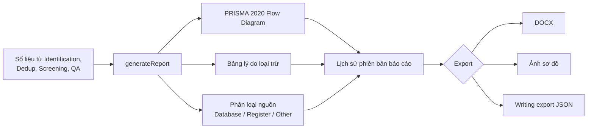

**Chức năng** (`prismaReportService`, `PrismaReportWorkspace`)
- Sinh báo cáo PRISMA, xem bản mới nhất / theo ID / lịch sử theo review process.
- Phân loại search source (classification) cho sơ đồ.
- Tải sơ đồ (DOCX / ảnh qua `html-to-image`), writing export JSON.
- Kết quả & evidence summary qua RQ Reporting (Synthesis).

**Số liệu trên sơ đồ PRISMA**: records identified (theo nguồn) → duplicates removed → records screened → excluded (TA) → reports sought / not retrieved → assessed for eligibility → excluded (FT, kèm lý do) → studies included.

> Các module đang **planned** (chưa có): Register protocol (OSF), SLR manuscript editor, Reporting checklist validation riêng.

---

## 7. Chức năng xuyên suốt (Cross-cutting)

| Chức năng | Mô tả | Thành phần |
|-----------|-------|------------|
| **Realtime** | Cập nhật tiến độ / thông báo qua SignalR | `signalrClient`, `useSignalR`, `SignalRConnectionManager` |
| **Notifications** | Dropdown + trang Notification Center, đếm chưa đọc, đánh dấu đã đọc / tất cả, điều hướng theo loại | `notificationService` |
| **Audit Log** | Nhật ký theo project (Leader) và toàn hệ thống (Admin), filter, xem chi tiết, export | `auditLogService` |
| **Notes** | Ghi chú theo process / bài | `NotesPanel`, `UpdateNotesModal` |
| **Document editor** | Soạn tài liệu (TipTap), import/export, preview | `components/ui/document-editor` |
| **PDF Viewer** | Xem PDF, tìm kiếm, zoom, highlight evidence | `PdfJsViewer`, `@react-pdf-viewer` |
| **AI** | Setup wizard, PICOC suggest, criteria generate, screening evaluate, auto-extract | các service tương ứng |
| **AI Agent API** | Agent ngoài nhận task screening, gửi vote INCLUDE/EXCLUDE/UNCERTAIN kèm evidence | Admin `AgentManagement` + project token |

---

## 8. Phân hệ Admin

Route gốc `/admin` (chỉ role `Admin`):

| Route | Trang | Chức năng |
|-------|-------|-----------|
| `/admin` | AdminOverview | Tổng quan hệ thống |
| `/admin/users` | UserManagement | Thêm, sửa, khoá/mở user, tìm kiếm, export Excel |
| `/admin/projects` | SLRProjectManagement | Quản lý mọi project, thành viên, mời/thay Leader, xoá/khôi phục |
| `/admin/agents` | AgentManagement | CRUD AI agent, bật/tắt |
| `/admin/master-sources` | MasterSourcePage | CRUD nguồn dữ liệu học thuật, bật/tắt, đếm mức sử dụng |
| `/admin/templates` | TemplateManager | Quản lý template (protocol/checklist) |
| `/admin/quality-criteria` | QualityCriteriaTemplates | Template tiêu chí QA dùng chung |
| `/admin/settings` | SystemSettings | Cấu hình hệ thống, exclusion code mặc định |
| `/admin/audit-logs` | AuditLogPage | Audit log toàn hệ thống |
| `/admin/notifications` | NotificationCenter | Thông báo |

---

## 9. Bản đồ Route

### Auth
| Route | Trang |
|-------|-------|
| `/auth/signin` | Đăng nhập |
| `/auth/policy` | Chính sách |

### Main (yêu cầu đăng nhập)
| Route | Trang |
|-------|-------|
| `/` | Home |
| `/profile` | Hồ sơ cá nhân |
| `/notifications` | Notification Center |
| `/invitations/:invitationId` | Chi tiết lời mời |
| `/projects` | Danh sách project |
| `/projects/:id/overview` | Tổng quan & protocol |
| `/projects/:id/workspace/:stepId` | Paper Pool 5 bước |
| `/projects/:id/settings` | Cài đặt, thành viên |
| `/projects/:id/audit-logs` | Audit log project |
| `/projects/:projectId/checklists[/:checklistId]` | PRISMA checklist |
| `/projects/:projectId/papers/:paperId` | Chi tiết bài báo |
| `/projects/:projectId/identification` | Identification (canonical) |
| `/projects/:projectId/screening[/dashboard \| /assignment-management \| /full-text]` | Screening (canonical) |
| `/projects/:projectId/quality-assessment` | QA (canonical) |
| `/projects/:projectId/extraction[/workspace/:studyId \| /grid]` | Data Extraction |
| `/projects/:projectId/synthesis/*` | Synthesis |
| `/projects/:projectId/prisma-report` | PRISMA Report |
| `/projects/:projectId/processes/:processId` | Review Process Workspace |
| `.../processes/:processId/identification/:identificationPhaseId` | Identification (Leader, Member) |
| `.../processes/:processId/screening/:screeningProcessId[/papers/:paperId]` | Screening router (role 1, 3) |
| `.../screening/:screeningProcessId/papers-statistic` | Thống kê (chỉ Leader) |
| `.../processes/:processId/full-text-screening/:screeningProcessId[/papers/:paperId]` | Full-text screening |
| `.../processes/:processId/quality-assessment/:qualityAssessmentId` | QA workspace |
| `.../processes/:processId/synthesis/*` | Synthesis |
| `.../processes/:processId/prisma-report` | PRISMA report |

---

## 10. Kiến trúc kỹ thuật Front-End

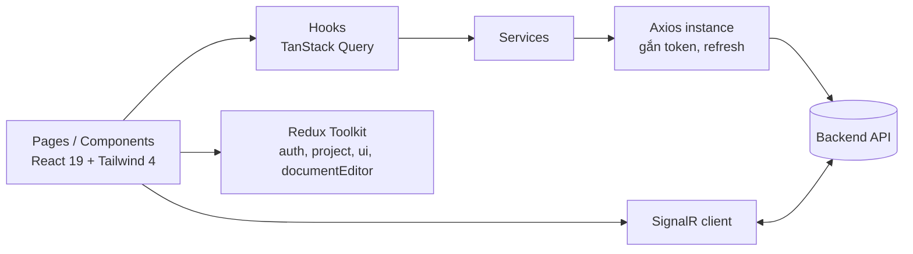

| Lớp | Công nghệ |
|-----|-----------|
| Build | Vite, TypeScript |
| UI | React 19, TailwindCSS 4, framer-motion, lucide/react-icons |
| State | Redux Toolkit (global), TanStack React Query (server state) |
| Form | react-hook-form |
| Bảng / Đồ thị | AG Grid, Recharts, Cytoscape (citation graph) |
| PDF | pdfjs-dist, @react-pdf-viewer |
| Editor | TipTap |
| Realtime | @microsoft/signalr |
| Auth ngoài | Firebase / Google SSO |
| Kiểm thử | Vitest |
| Deploy | Docker + Nginx, Vercel |
